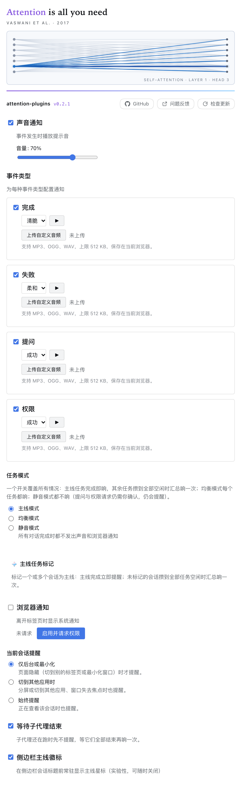
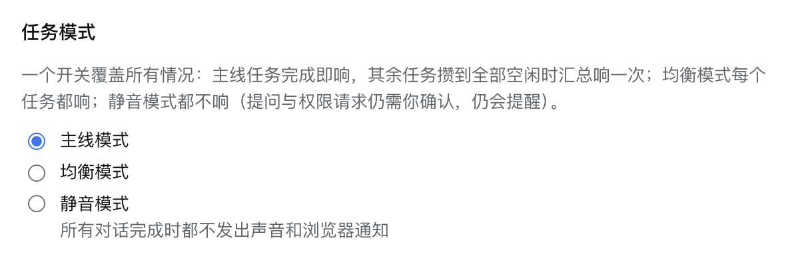
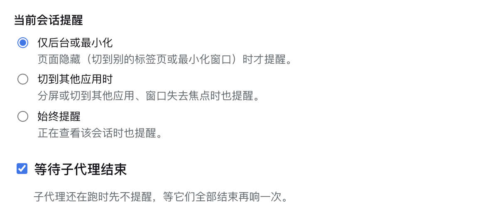
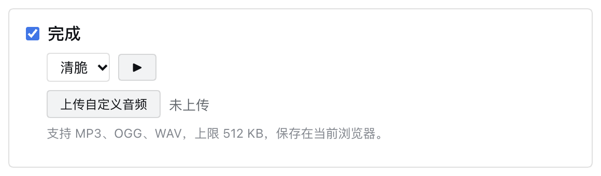
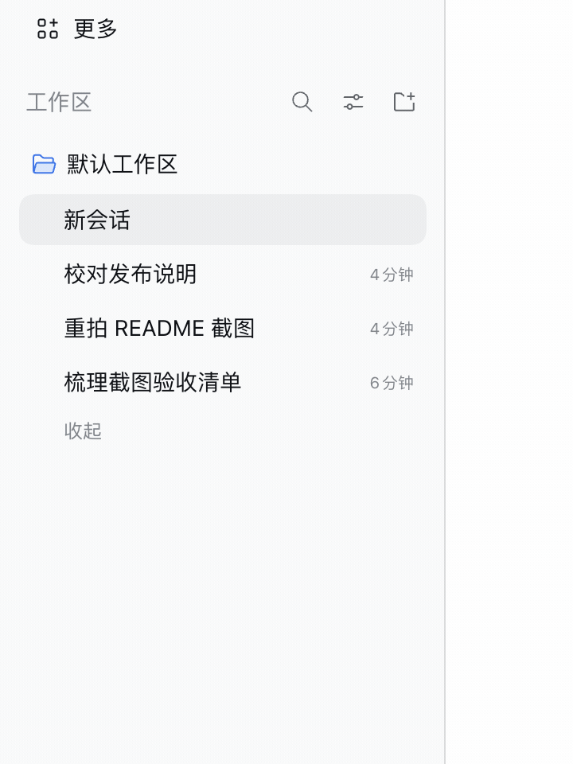
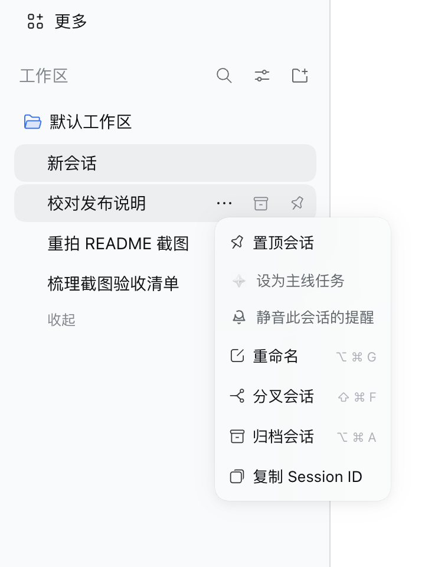
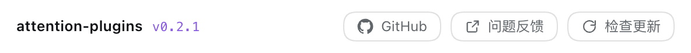

<h1 align="center">attention-plugins</h1>

<p align="center">
  <strong>Task-priority notifications for DeepSeek Harness.</strong><br/>
  Mark the sessions you are waiting for — they ring the moment they finish. Everything else rings once, together, when the whole wave is idle.<br/>
  <em>DSH 任务分级通知：主线完成即响，其余攒到全部空闲汇总一声。</em>
</p>

<p align="center">
  <a href="https://www.npmjs.com/package/attention-plugins"></a>
  <a href="https://www.npmjs.com/package/attention-plugins"></a>
  <a href="LICENSE"></a>
  <a href="tests/"></a>
  
</p>

<p align="center">
  <br/>
  <sub>Settings → Attention, full panel (click to enlarge) · 设置面板全貌（点开看大图）</sub>
</p>

<p align="center"><code>dsh plugin add attention-plugins@0.2.2</code></p>

<p align="center"><a href="#english">English</a> · <a href="#中文">中文</a> · <a href="CHANGELOG.md">Changelog</a></p>

<p align="center">
  <br/>
  <sub>Three task modes · 任务模式三档</sub>
</p>

<p align="center">
  
  <br/>
  <sub>Current-session tiers · custom audio per event type · 当前会话三档 · 每类事件自定义音频</sub>
</p>

<p align="center">
  
  
  <br/>
  <sub>Session row "…" menu · meta bar · 会话行菜单 · 信息栏</sub>
</p>

## English

### Why this exists

Running five DSH sessions at once is normal. A notifier that fires on every completion interrupts you five times, while you are usually waiting for exactly one of them. The real cost is not the sound — it is that after a few false alarms you stop trusting it and check the screen anyway.

attention-plugins gives sessions a priority. Mark what you are waiting for and it rings the moment it lands; everything else is pooled into a single "All tasks" chime when the wave goes idle.

```text
Session A  ★ marked   ──done──▶  🔔 ring now
Session B    unmarked ──done──▶  (pooled)
Session C    unmarked ──done──▶  └── all idle ──▶ 🔔 "All tasks"
```

**Main-line** (default) · **Balanced** (every session rings) · **Silent** (completions stay quiet; questions and permission requests still alert).

|  | A plain four-event notifier | attention-plugins |
|---|---|---|
| When it rings | Every finished session | Marked sessions now, the rest once per wave |
| Modes | One global switch | Main-line / balanced / silent |
| Granularity | Per event type | Per event type, per session, per marker |

### Install

The package ships its built `lib/`, so there is nothing to compile:

```bash
dsh plugin add attention-plugins@0.2.2
dsh web
```

Update with `dsh plugin update attention-plugins@0.2.2`; remove with `dsh plugin remove attention-plugins`. If npm is unreachable, install the prebuilt tarball from [Releases](https://github.com/zjbc2000/attention-plugins/releases) instead: `dsh plugin add https://github.com/zjbc2000/attention-plugins/releases/download/v0.2.2/attention-plugins-0.2.2.tgz`.

From source, for development or an unreleased commit:

```bash
git clone https://github.com/zjbc2000/attention-plugins.git
cd attention-plugins
pnpm install && pnpm run build
dsh plugin add link:/path/to/attention-plugins
dsh web
```

`/path/to/attention-plugins` is this checkout — inside the repo, `link:"$(pwd)"` does the same. `link:` points DSH at the source directory, so a later `git pull && pnpm run build` is enough; `file:` copies the package into `node_modules` and needs a fresh `add` after every change.

### Quick start

1. Install and start `dsh web`.
2. Open **Settings → Attention** — the plugin registers its own settings tab.
3. Mark a main line: click **☆** left of a session's composer — it works before a new session sends its first message — or use the session row's "…" menu. Mark as many as you like.
4. Keep the default main-line mode. If you would rather not mark anything but still hear every task, switch to **balanced**.
5. Press **▶** on an event card once — browsers need a user gesture before they play audio.

### How alerting works

| What happens | Main-line (default) | Balanced | Silent |
|---|---|---|---|
| A marked session completes or fails | Rings immediately | Rings immediately | Silent |
| An unmarked session completes or fails | Pooled: one "All tasks" chime when every session is idle | Rings immediately | Silent |
| A muted session, whatever its state | Silent | Silent | Silent |
| A question or permission request | Rings immediately | Rings immediately | Rings immediately |

Two rules worth knowing:

- The aggregate fires only if that wave actually pooled something. A wave made of main-line sessions alone stays quiet.
- Question and permission alerts still respect their own event switch and the current-session setting.

### Features

| Feature | What it does |
|---|---|
| **Three task modes** | Main-line, balanced, silent — one setting covers marked sessions, unmarked ones, and "do not tell me". |
| **Multiple main-line markers** | Mark any number of sessions from the composer ☆, the session row "…" menu, or the sidebar star; clearing one star leaves the others alone. |
| **Four event types** | Completed, failed, question, permission — each with its own switch and built-in sound. |
| **Three built-in sounds** | Chime / Success / Subtle, synthesized with Web Audio (no audio files shipped); volume 0–100%. |
| **Custom audio per event type** | MP3 / OGG / WAV up to 512 KB, stored in this browser and played for that event type only. |
| **Browser notifications** | One tag per event type and session with `renotify`, so a question never replaces an unread completion; questions and permissions ask to stay on screen; clicking one opens that session. |
| **Current-session tiers** | Background or minimized only / when the window is unfocused (split screen included) / always. |
| **Wait for subagents** | A parent that finished while its subagents still run stays quiet; the wave rings once when the last child is idle. |
| **Per-session mute** | Silence a single session from its "…" menu without touching global settings. |
| **Settings meta bar** | Version, GitHub, issues, and **Check for updates**, which reads the npm registry only when pressed; English and Chinese UI; follows `prefers-reduced-motion`. |

### Settings reference

| Setting | What it does | Default |
|---|---|---|
| Sound notifications | Master switch for sounds | On |
| Volume | Playback volume, 0–100% | 70% |
| Event types | Per-type switch, sound, and custom audio | All on; Chime / Subtle / Success / Success |
| Task mode | Main-line / balanced / silent | Main-line |
| Browser notifications | System notifications; asks for permission when enabled; click opens the session | Off |
| Current-session alerts | Background or minimized / unfocused / always | Background or minimized |
| Wait for subagents | Hold a finished parent until its children are idle | On |
| Sidebar main-line star | Show a star for marked sessions in the sidebar | On |
| Main-line markers | Which sessions count as main-line | None |
| Muted sessions | Sessions that never alert | None |

### What's new in 0.2.2

- **Three task modes replace the old side-line alerting setting.** Existing configs migrate on load: per-session → balanced, batch → main-line.
- **Click a notification to open its session**, and per-event notification tags so alerts no longer overwrite each other.
- **Current-session alerts are three tiers** instead of a boolean — split screen is no longer permanently muted.
- **Wait for subagents, per-session mute, and custom audio for every event type.**
- **Meta bar** with the installed version, GitHub, issues, and a manual update check.
- **Fixes**: the "All tasks" aggregate could ring twice in one wave; three 💡 teaching notes are gone from the settings panel.

Full list in [CHANGELOG.md](CHANGELOG.md). Next up: a notification history view.

### FAQ

**No sound at all?** Browsers block audio until the page has seen a user gesture — press **▶** on any event card once. Check the system volume and output device too; the plugin rebuilds its `AudioContext` after the output device changes (switching to Bluetooth, for example), so the first chime is not swallowed.

**No browser notifications?** Turn them on in the panel and grant permission when asked. They only appear while the tab is in the background — a visible tab is not notified on purpose. On macOS the browser also needs notification permission in System Settings.

**In main-line mode with nothing marked, does it ring?** Yes, once: every session counts as unmarked, so a single "All tasks" chime fires when all of them are idle. Switch to balanced if you want each one separately.

**Can a session ring twice — once for itself and once in the aggregate?** No. Marked sessions ring on their own and are excluded from the pool; balanced mode never aggregates; silent mode emits neither.

**Where is the state stored?** `localStorage` key `attention-plugins:config` — this browser only, not synced across browsers or devices.

**How do I roll back?** Pin a version: `dsh plugin add attention-plugins@0.2.1`, then reopen Settings → Attention and re-check task mode and current-session alerts. The config key is unchanged, but older builds read a few fields differently.

### Under the hood

- Run state comes from the `api-session/status` remote event; pending questions and permissions from `uiSession.sessionStatus.pendingInteraction`.
- Completion is `running: true → false`; after a settle window, errors added during that turn split "completed" from "failed".
- Pending state has no remote event, so the first frame records a baseline only — opening the page does not replay a burst of alerts.
- Gating order: event switch → current session / page visibility → notification permission.
- Injection points: `conversation.input.left` and `sidebar.workspaces.session.menu.item`; the sidebar star is DOM-injected.

### Requirements

Node.js 20 or newer, DeepSeek Harness 0.1.7 or newer. Developed and verified end to end on 0.2.1-rc.2, and against the 0.2.1-rc.4 install layer. Older DSH releases used a different session-store API and are not supported.

### Development

```bash
pnpm install
pnpm run build     # tsc + client bundle
pnpm run watch     # rebuild on change
pnpm test          # unit tests
pnpm run clean
pnpm run shots -- launch   # isolated instance + headless Chrome (docs/SHOTS.md)
```

Tests: **12 files / 181 cases** — engine 35, mainline-sideline-advanced 21, custom-audio 18, mainline-mode 16, notification 13, session-lookup 13, version 13, sound-params 15, policy 11, pending 10, settings-normalize 10, meta-bar 6.

After a build, a client-bundle change only needs a browser refresh; a server-side change needs the plugin reloaded: `printf '\n# reload %s\n' "$(date +%s)" >> ~/.dsh/profiles/web/cordis.patch.yml`.

### Credits

Architecture based on [@dingyi222666/dsh-session-notification](https://github.com/dingyi222666/dsh-session-notification) (BSD-3-Clause; the retained notice is in [THIRD-PARTY-NOTICES.md](THIRD-PARTY-NOTICES.md)), rewritten around task priority: main-line markers, three modes, per-session mute. Listed in the DSH community plugin directory (awesome-dsh-plugin#8802). If it saves you a few interruptions, a ⭐ on GitHub is the best thanks.

### License

MIT — see [LICENSE](LICENSE).

---

## 中文

### 为什么做这个插件

在 DSH 里同时开五个会话，已经是常态。如果每个会话跑完都响一声，你会在等其中一个的时候被打断五次。真正的问题不是那一声提示音，而是响得太多之后你开始不信任它，每次还是要自己切回去看。

attention-plugins 给会话排优先级：标成主线的完成即响，其余攒到这一波全部空闲时汇总响一声「All tasks」。

```text
会话 A  ★ 主线   ──完成──▶  🔔 立即响
会话 B    未标记 ──完成──▶  （攒着）
会话 C    未标记 ──完成──▶  └── 全部空闲 ──▶ 🔔「All tasks」
```

**主线模式**（默认）· **均衡模式**（每个会话都响）· **静音模式**（完成不响，提问与权限请求照常提醒）。

|  | 基础的四事件通知插件 | attention-plugins |
|---|---|---|
| 什么时候响 | 每个会话跑完都响 | 主线立即响，其余每波汇总一次 |
| 模式 | 通常只有一个总开关 | 主线 / 均衡 / 静音三档 |
| 控制粒度 | 按事件类型 | 按事件类型、按会话静音、按主线标记 |

### 安装

包内已经带好构建产物 `lib/`，不需要本地编译：

```bash
dsh plugin add attention-plugins@0.2.2
dsh web
```

更新：`dsh plugin update attention-plugins@0.2.2`。卸载：`dsh plugin remove attention-plugins`。访问不了 npm 时，可以改装有预构建产物的 [Release tarball](https://github.com/zjbc2000/attention-plugins/releases)：`dsh plugin add https://github.com/zjbc2000/attention-plugins/releases/download/v0.2.2/attention-plugins-0.2.2.tgz`。

从源码安装，改代码或跑未发布的提交时用：

```bash
git clone https://github.com/zjbc2000/attention-plugins.git
cd attention-plugins
pnpm install && pnpm run build
dsh plugin add link:/path/to/attention-plugins
dsh web
```

`/path/to/attention-plugins` 换成这个 checkout 的绝对路径，在仓库里直接写 `link:"$(pwd)"` 效果一样。`link:` 让 DSH 直接引用源码目录，以后 `git pull && pnpm run build` 就够了；`file:` 会把包复制进 `node_modules`，每次改动都得重新 add。

### 快速上手

1. 装好，然后运行 `dsh web`。
2. 打开 **Settings → Attention**——插件通过 `settings.section` 注册了自己的设置页签。
3. 标一个主线：点输入框左侧的 **☆**（新会话发出第一条消息之前就能用），或用会话行「…」菜单。想标几个都行。
4. 保持默认的主线模式即可；不想标主线、又希望每个任务各自响，就切到**均衡模式**。
5. 点一次事件卡片上的 **▶**——浏览器要先看到用户手势，之后才会出声。

### 提醒规则

| 情况 | 主线模式（默认） | 均衡模式 | 静音模式 |
|---|---|---|---|
| 标记过的会话完成或失败 | 立即响 | 立即响 | 不响 |
| 未标记的会话完成或失败 | 攒着，等所有会话空闲后汇总响一声「All tasks」 | 立即响 | 不响 |
| 被静音的会话，不论状态 | 不响 | 不响 | 不响 |
| 提问或权限请求 | 立即响 | 立即响 | 立即响 |

两条规则：

- 汇总只在「这一波确实攒下了任务」时才响；整波都是主线时不会再补一声。
- 提问与权限请求同样受各自的开关和「当前会话提醒」设置约束。

### 功能

| 功能 | 说明 |
|---|---|
| **三档任务模式** | 主线 / 均衡 / 静音——一个设置同时管住标记过的、没标记的，以及「别烦我」。 |
| **多主线标记** | 输入框 ☆、会话行「…」菜单、侧栏星标三个入口，可同时标多个；点某颗星只取消那一个。 |
| **四类事件** | 完成、失败、提问、权限请求，每类独立开关、独立音效。 |
| **三种内置音效** | Chime / Success / Subtle，Web Audio 实时合成，不加载音频文件；音量 0–100%。 |
| **每类事件自定义音频** | MP3 / OGG / WAV，≤ 512 KB，只存在当前浏览器，也只对这一类事件生效。 |
| **浏览器通知** | 每类事件、每个会话各一个 tag 并带 `renotify`，提问不会顶掉未读的完成通知；提问与权限请求要求常驻显示；点击直达对应会话。 |
| **当前会话提醒三档** | 仅后台或最小化 / 切到其他应用时（分屏也算）/ 始终提醒。 |
| **等待子代理结束** | 父会话跑完但子代理还在跑时先不响，整波结束再提醒一次。 |
| **按会话静音** | 在会话行「…」菜单里单独静音，不动全局设置。 |
| **设置页信息栏** | 版本号、GitHub、问题反馈，以及只有点击时才读 npm registry 的**检查更新**；中英双语界面；遵循 `prefers-reduced-motion`。 |

### 设置项

| 设置 | 说明 | 默认 |
|---|---|---|
| 声音通知 | 声音总开关 | 开 |
| 音量 | 播放音量，0–100% | 70% |
| 事件类型 | 逐项开关、音效与自定义音频 | 全开；Chime / Subtle / Success / Success |
| 任务模式 | 主线 / 均衡 / 静音 | 主线 |
| 浏览器通知 | 系统通知，开启时请求授权；点击通知打开会话 | 关 |
| 当前会话提醒 | 仅后台或最小化 / 失焦时 / 始终 | 仅后台或最小化 |
| 等待子代理结束 | 子代理还在跑时先压住父会话的提醒 | 开 |
| 侧栏主线星标 | 在侧栏给已标记会话加星 | 开 |
| 主线标记 | 哪些会话算主线 | 无 |
| 静音会话 | 永不提醒的会话 | 无 |

### 0.2.2 更新

- **三档任务模式上线，旧的支线提醒设置合并移除。** 已有配置在加载时自动迁移：按会话 → 均衡，批量 → 主线。
- **点击通知直达对应会话**；通知按事件类型独立 tag，不再互相覆盖。
- **当前会话提醒从布尔开关升级为三档**——分屏时不再永远静音。
- **新增等待子代理结束、按会话静音、每类事件自定义音频。**
- **设置页信息栏**：版本号、GitHub、问题反馈、手动检查更新。
- **修复**：同一波「All tasks」汇总会重复响两次；设置页删掉了三处 💡 教学式注释。

完整列表见 [CHANGELOG.md](CHANGELOG.md)。下一步计划：通知历史。

### 常见问题

**一点声音都没有？** 浏览器在页面收到用户手势之前不允许播放音频，先点任意事件卡片上的 **▶** 一次。再顺手看一眼系统音量和输出设备；输出设备变化后（比如切到蓝牙）插件会重建 `AudioContext`，所以第一声不会被吞掉。

**浏览器通知不出现？** 先在面板里打开并授权。它只在标签页切到后台时弹出，页面在前台是有意不弹的。macOS 上还要在系统设置里允许浏览器发通知。

**主线模式下一个主线都没标，还会响吗？** 会，响一次：所有会话都算未标记，全部空闲时汇总响一声「All tasks」。想每个都单独响就切均衡模式。

**同一个会话会响两次吗（自己一次、汇总再一次）？** 不会。标记过的自己响、不进汇总池；均衡模式从不汇总；静音模式两者都不发。

**标记和设置存在哪？** `localStorage` 的 `attention-plugins:config`，只在这一个浏览器里，不跨浏览器、不跨设备同步。

**怎么回滚？** 钉住版本即可：`dsh plugin add attention-plugins@0.2.1`，然后重新打开 Settings → Attention，确认一下任务模式和当前会话提醒。配置的 key 没变，但旧版本对其中几个字段的读法不同。

### 实现要点

- 运行状态来自 `api-session/status` 远程事件；提问与权限来自 `uiSession.sessionStatus.pendingInteraction`。
- 完成判定为 `running: true → false`；经过 settle 窗口后，按本轮新增的错误区分「完成」与「失败」。
- 提问与权限没有对应的远程事件，首帧只记录基线——打开页面不会补发一堆通知。
- 通知门控顺序：事件开关 → 当前会话 / 页面可见性 → 通知权限。
- 注入点：`conversation.input.left` 与 `sidebar.workspaces.session.menu.item`；侧栏星标通过 DOM 注入。

### 环境要求

Node.js 20 及以上，DeepSeek Harness 0.1.7 及以上。端到端验证于 0.2.1-rc.2，安装层验证于 0.2.1-rc.4。更早的 DSH 版本用的是另一套会话 store API，不受支持。

### 开发

```bash
pnpm install
pnpm run build     # tsc + 客户端 bundle
pnpm run watch     # 监听编译
pnpm test          # 单元测试
pnpm run clean
pnpm run shots -- launch   # 隔离实例 + 无头 Chrome（见 docs/SHOTS.md）
```

测试：**12 个文件 / 181 个用例**——engine 35、mainline-sideline-advanced 21、custom-audio 18、mainline-mode 16、notification 13、session-lookup 13、version 13、sound-params 15、policy 11、pending 10、settings-normalize 10、meta-bar 6。

构建之后，只改了客户端 bundle 刷新浏览器即可；改了服务端文件则让插件重新加载：`printf '\n# reload %s\n' "$(date +%s)" >> ~/.dsh/profiles/web/cordis.patch.yml`。

### 致谢

架构基于 [@dingyi222666/dsh-session-notification](https://github.com/dingyi222666/dsh-session-notification)（上游为 BSD-3-Clause，保留的版权声明见 [THIRD-PARTY-NOTICES.md](THIRD-PARTY-NOTICES.md)），围绕任务优先级重写：主线标记、三档模式、按会话静音。已收录进 DSH 社区插件目录（awesome-dsh-plugin#8802）。如果它帮你少被打断几次，在 GitHub 上点个 ⭐ 就是最好的支持。

### 许可证

MIT，详见 [LICENSE](LICENSE)。
