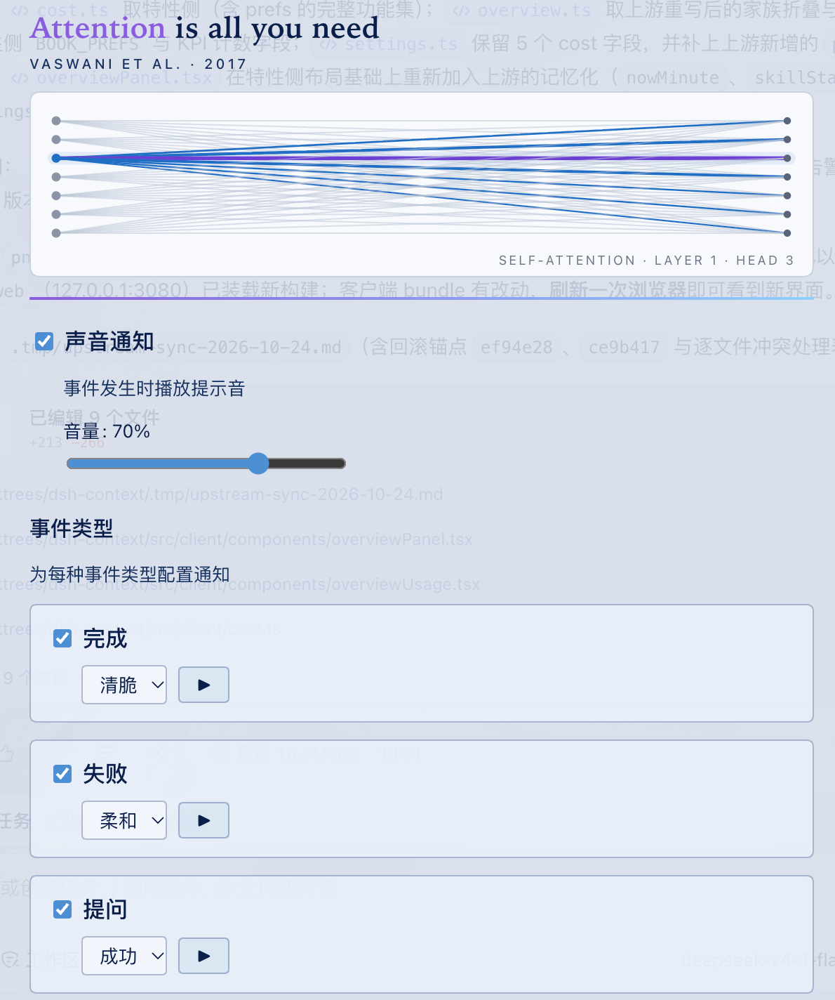
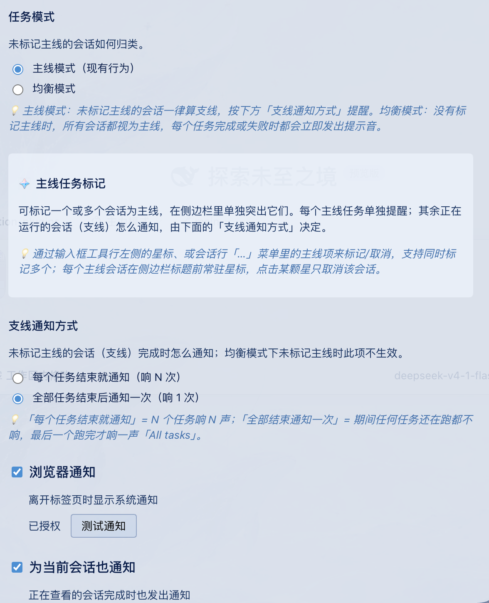

<h1 align="center">attention-plugins</h1>

<p align="center">
  <strong>DSH 任务通知，按「主线 / 支线」分级。</strong><br/>
  只让主线任务打断你，其余任务攒到全部结束再提醒。<br/>
  <em>Task-priority notifications for DeepSeek Harness — only the tasks you care about interrupt you.</em>
</p>

<p align="center">
  <a href="https://github.com/zjbc2000/attention-plugins/stargazers"></a>
  <a href="https://github.com/zjbc2000/attention-plugins/actions/workflows/ci.yml"></a>
  <a href="LICENSE"></a>
  <a href="./tests/"></a>
  
</p>

<p align="center"><a href="#中文">中文</a> · <a href="#english">English</a></p>

## 截图 / Screenshots

<p align="center">
  
  
</p>

<p align="center"><sub>Settings → Attention：声音与事件类型 · 任务模式与支线通知</sub><br/>
<sub>Settings → Attention: sounds &amp; event types · task mode &amp; side-line alerts</sub></p>

---

## 中文

### 为什么做这个插件

在 DSH 里同时开五个会话是常态。默认「每个任务完成都提醒」会让你在五个任务之间被五次打断——而你真正在等的往往只有一个。

attention-plugins 让任务有主次：

```
会话 A  ★ 主线 ──完成──▶ 🔔 立即提醒
会话 B    支线 ──完成──▶ 🔔（每个任务都提醒）/ 静默（汇总模式）
会话 C    支线 ──完成──▶ 🔔（每个任务都提醒）/ 静默（汇总模式）
                              └── batch：全部空闲 ──▶ 🔔 All tasks
```

- **主线**：你正在等的任务，完成或失败立即提醒。
- **支线**：后台跑的任务，可以逐个提醒，也可以等全部结束只响一声。
- **提问 / 权限请求**：无论主次立即提醒——它们会阻塞任务，漏掉的代价最大。

### 功能

- 🎯 **任务模式**：`主线模式`（默认）与 `均衡模式` 可切换。均衡模式下，只要你一个主线都没标，所有会话都按主线处理，每个任务完成/失败都立即提醒——适合「所有任务都重要」的场景。
- ⭐ **多主线**：输入框工具行、会话行「…」菜单都能标记，可同时标记多个；侧栏会给已标记的会话加常驻星标。
- 🔔 **支线通知方式**：`每个任务结束就提醒`（默认）或 `全部结束提醒一次`。
- ✅ **4 类事件**：完成、失败、提问、权限请求，每类独立开关、独立音效。
- 🔊 **3 种内置音效**：Chime / Success / Subtle，Web Audio 实时合成，不含音频文件；音量 0–100%。
- 🖥 **浏览器通知**：切到其他标签页时弹系统通知；可额外开启「为当前会话也通知」。
- 🌗 **中英双语设置面板**，遵循 `prefers-reduced-motion`。

### 安装

**要求**：DeepSeek Harness 0.1.7+（开发与验证环境为 0.2.1-rc.2）。更早版本的会话 store API 已不适用。

**推荐：npm**（一条命令，无需本地构建）：

```bash
dsh plugin --profile web add attention-plugins
dsh web
```

包内已带 `lib/`，安装后即可使用。访问不了 npm 时，可改用 [GitHub Release 预构建包](https://github.com/zjbc2000/attention-plugins/releases)：
`dsh plugin --profile web add "https://github.com/zjbc2000/attention-plugins/releases/download/v0.2.0/attention-plugins-0.2.0.tgz"`。

**从源码安装**：

```bash
git clone https://github.com/zjbc2000/attention-plugins.git
cd attention-plugins
pnpm install
pnpm run build
dsh plugin --profile web add link:"$(pwd)"
dsh web
```

> 用 `link:` 安装时 DSH 直接引用源码目录：以后 `git pull && pnpm run build` 再刷新浏览器即可。用 `file:` 会复制一份到 `node_modules`，每次更新都要重新 `add`。

**更新**：

```bash
# npm：重新安装即可拿到 latest
dsh plugin --profile web add attention-plugins

# 源码 / link: 安装：
git pull && pnpm install && pnpm run build

# 只改了客户端 bundle：刷新浏览器即可
# 改了 src/index.ts 等服务端文件时，让 DSH 重新加载：
printf '\n# reload %s\n' "$(date +%s)" >> ~/.dsh/profiles/web/cordis.patch.yml
```

### 30 秒上手

1. 打开 **Settings → Attention**。
2. 在任意会话的输入框左侧点 **☆**，或会话行「…」→「设为主线任务」；可以同时标多个。
3. 默认的主线模式就够用：主线即时提醒，支线按「支线通知方式」处理。
4. 如果没标主线、又希望每个任务都提醒：把任务模式切成「均衡模式」。
5. 点事件卡片上的 ▶ 试听音效，顺便确认音量。

### 通知规则

| 情况 | 主线模式（默认） | 均衡模式 |
|---|---|---|
| 标了至少一个主线 | 标记的会话完成/失败立即提醒；未标记的按「支线通知方式」。 | 与主线模式完全相同（有标记时按标记走）。 |
| 没有任何标记 | 所有会话都算支线，按「支线通知方式」。 | 所有会话都算主线，完成/失败逐个立即提醒，不产生汇总提醒。 |
| 提问 / 权限请求 | 始终立即提醒（仍受事件开关和「当前会话」设置影响）。 | 同左。 |

**支线通知方式**：

- **每个任务结束就提醒**：N 个任务响 N 声，不做汇总。
- **全部结束提醒一次**：支线完成时保持安静，等所有运行中的会话都空闲，汇总一声「All tasks」；如果最后结束的是主线，不会再补一次汇总（避免重复）。注意：batch 模式下支线的**失败**也会进入汇总，不会单独提醒。

### 设置项

**Settings → Attention**：

| 设置 | 说明 | 默认 |
|---|---|---|
| 🔊 声音通知 | 声音总开关 | 开 |
| 🔉 音量 | 0–100% | 70% |
| 🎵 事件类型 | 完成 / 失败 / 提问 / 权限，逐项开关与音效 | 全开 |
| 🎯 任务模式 | 主线模式 / 均衡模式 | 主线模式 |
| 🔔 支线通知方式 | 每个任务结束就提醒 / 全部结束提醒一次 | 每个任务结束就提醒 |
| 🖥 浏览器通知 | 系统通知，需授权 | 关 |
| 👁 为当前会话也通知 | 正在查看的会话也响 | 关 |
| ⭐ 侧栏主线星标 | 在侧栏为已标记会话加星 | 开 |

事件默认音效：完成 `Chime`、失败 `Subtle`、提问 `Success`、权限 `Success`。

### 标记主线的三个入口

- **输入框工具行**：左侧的 ☆/⭐ 小图标，新会话发出第一条消息之前就能用。
- **会话行「…」菜单**：「设为主线任务」/「取消主线标记」。
- **侧栏星标**：已标记会话的标题前会显示 ⭐；点某颗星只取消该会话的标记。

### 常见问题

**为什么没有声音？**
浏览器要求先有一次用户手势才允许播放音频。点任意事件卡片上的 ▶ 试听一次即可解锁；同时检查系统音量、静音状态和输出设备。切换蓝牙设备后插件会重建 `AudioContext`，避免第一声被吞。

**浏览器通知不出现？**
需要先在设置里授权；系统通知只在页面切到后台时弹出；macOS 还需在系统设置中允许浏览器发送通知。

**主线和支线会重复响吗？**
不会。`per-session` 模式不产生汇总提醒；`batch` 模式下主线即时提醒、支线汇总提醒，且主线刚完成时会抑制汇总。

**标记和设置存在哪里？**
浏览器 `localStorage` 的 `attention-plugins:config`，不跨浏览器或设备同步。

**为什么设置面板在 Settings → Attention？**
插件通过 `settings.section` 注册了自己的设置页签。

### 实现要点

- 会话运行状态来自 `api-session/status` 远程事件；提问/权限来自 `uiSession.sessionStatus.pendingInteraction`。
- 完成判定为 `running: true → false`，经过 settle 窗口后，按本轮新增错误区分「完成」与「失败」。
- 提问/权限没有对应的远程事件，首帧只记录基线，避免打开页面时补发一堆通知。
- 通知门控顺序：事件开关 → 当前会话 / 页面可见性 → 浏览器通知权限。
- 音效由 Web Audio 实时合成；设备变化后重建上下文。
- 注入点：`conversation.input.left`、`sidebar.workspaces.session.menu.item`；侧栏星标通过 DOM 注入实现。

### 开发

```bash
pnpm install      # 安装依赖
pnpm run build    # tsc + 打包客户端 bundle
pnpm run watch    # 监听编译
pnpm test         # 单元测试
pnpm run clean    # 清理 lib/
```

测试：6 个文件 / 92 个用例。

```
✓ tests/engine.test.ts                     (27)
✓ tests/mainline-sideline-advanced.test.ts (21)
✓ tests/sound-params.test.ts               (15)
✓ tests/mainline-mode.test.ts              (13)
✓ tests/pending.test.ts                    (10)
✓ tests/settings-normalize.test.ts          (6)
```

### 路线图

- [x] 4 类事件（完成 / 失败 / 提问 / 权限）
- [x] 主线 / 支线分级与多主线标记
- [x] 任务模式（主线模式 / 均衡模式）
- [x] 支线通知方式（per-session / batch）
- [x] 3 种内置音效、音量、浏览器通知
- [x] 中英双语设置面板
- [x] npm 发布（`attention-plugins@0.2.0`）
- [ ] 社区目录收录（PR 待合并）
- [ ] 更多音效 / 自定义音频
- [ ] 每个会话单独静音
- [ ] 通知历史

### 致谢

基于 [@dingyi222666/dsh-session-notification](https://github.com/dingyi222666/dsh-session-notification) 的架构（MIT License）重写，扩展了主线/支线分级与任务模式。

如果这个插件帮你少被打断几次，点个 ⭐ 就是最好的支持。

### 许可证

MIT License — 详见 [LICENSE](LICENSE)。

---

## English

### Why

Five parallel DSH sessions is normal. "Notify me when anything finishes" interrupts you five times, while you are usually waiting for exactly one of them.

attention-plugins gives tasks a priority:

- **Main-line** tasks alert immediately when they complete or fail.
- **Side-line** tasks can alert one by one, or stay quiet until every running task finishes and then ring once.
- **Questions / permission requests** always alert — they block the task, and missing them is expensive.

### Features

- 🎯 **Task mode**: `mainline` (default) or `balanced`. In balanced mode, as long as nothing is marked, every session counts as main-line and alerts on its own completion — useful when all tasks matter.
- ⭐ **Multiple main-line markers**: mark any number of sessions from the composer tool row or a session row's "…" menu; marked sessions keep a star in the sidebar.
- 🔔 **Side-line alerts**: per finished task (default) or a single aggregate alert when all tasks finish.
- ✅ **4 event types**: completed, failed, question, permission — each with its own switch and sound.
- 🔊 **3 built-in sounds**: Chime / Success / Subtle, synthesized with Web Audio (no audio assets); volume 0–100%.
- 🖥 **Browser notifications** when the tab is in the background; optional alerts for the current session too.
- 🌗 **Bilingual settings panel** (English / Chinese), respects `prefers-reduced-motion`.

### Install

**Requires** DeepSeek Harness 0.1.7+ (developed and verified against 0.2.1-rc.2).

**Recommended: npm** (one command, no local build):

```bash
dsh plugin --profile web add attention-plugins
dsh web
```

The package ships `lib/`, so it works right after install. If you cannot reach npm, use the [prebuilt GitHub Release tarball](https://github.com/zjbc2000/attention-plugins/releases) instead:
`dsh plugin --profile web add "https://github.com/zjbc2000/attention-plugins/releases/download/v0.2.0/attention-plugins-0.2.0.tgz"`.

**Install from source**:

```bash
git clone https://github.com/zjbc2000/attention-plugins.git
cd attention-plugins
pnpm install
pnpm run build
dsh plugin --profile web add link:"$(pwd)"
dsh web
```

Update a source install with `git pull && pnpm install && pnpm run build`, then refresh the browser. If a server-side file changed, touch `~/.dsh/profiles/web/cordis.patch.yml` to reload the plugin.

### Quick start

1. Open **Settings → Attention**.
2. Click **☆** at the left of a session's composer, or use the session row's "…" menu, to mark it as main-line. Mark as many as you like.
3. Keep the default `mainline` task mode: main-line alerts immediately, side-line follows the side-line alert mode.
4. Prefer every task to alert while nothing is marked? Switch to `balanced`.

### Notification rules

| Situation | Mainline mode (default) | Balanced mode |
|---|---|---|
| At least one marker set | Marked sessions alert immediately; unmarked sessions follow the side-line mode. | Same as mainline mode (markers win). |
| Nothing marked | Every session is side-line and follows the side-line mode. | Every session is main-line and alerts individually; no aggregate alert. |
| Question / permission | Always alerts (still subject to event switches and the current-session setting). | Same. |

**Side-line mode**:

- **Per finished task**: N tasks ring N times, no aggregate.
- **Once, when all finish**: side-line completions stay silent; when every running session is idle, one "All tasks" alert fires. If the last completion was main-line, the aggregate is suppressed to avoid a duplicate. Note: in batch mode a side-line **failure** is also folded into the aggregate instead of alerting on its own.

### Settings

| Setting | Description | Default |
|---|---|---|
| 🔊 Sound notifications | Master switch for sounds | On |
| 🔉 Volume | 0–100% | 70% |
| 🎵 Event types | Per-event switch and sound for completed / failed / question / permission | All on |
| 🎯 Task mode | Mainline / balanced | Mainline |
| 🔔 Side-line alerts | Per finished task / once when all finish | Per finished task |
| 🖥 Browser notifications | System notifications (permission required) | Off |
| 👁 Alert for current session | Also alert for the session you are viewing | Off |
| ⭐ Sidebar star | Show a star for marked sessions in the sidebar | On |

### FAQ

**No sound?** Browsers require a user gesture first — press ▶ on any event card once. Also check system volume, mute, and output device; the plugin recreates its `AudioContext` after device changes.

**No browser notifications?** Grant permission in settings; they only appear while the tab is in the background; on macOS the browser also needs notification permission in System Settings.

**Duplicate alerts?** No. `per-session` mode never emits the aggregate; `batch` mode alerts main-line sessions immediately and suppresses the aggregate when the last completion was main-line.

**Where is state stored?** `localStorage` key `attention-plugins:config`; it is not synced across browsers or devices.

### Development

```bash
pnpm install
pnpm run build
pnpm run watch
pnpm test
pnpm run clean
```

6 test files / 92 tests.

### Credits

Based on the architecture of [@dingyi222666/dsh-session-notification](https://github.com/dingyi222666/dsh-session-notification) (MIT), rewritten with main-line / side-line prioritization.

### License

MIT License — see [LICENSE](LICENSE).
